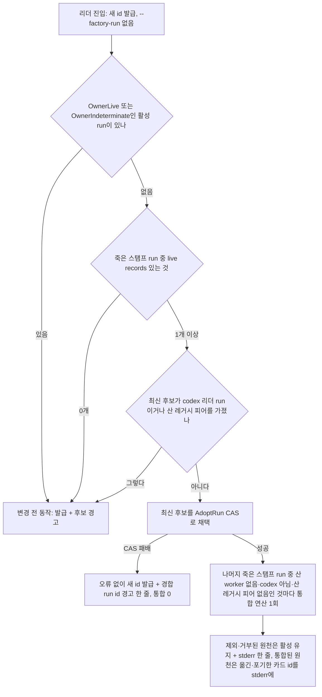

# design.md — SPEC-FACTORY-COMPLETION-RECOVERY-001

M1·M2(원래 범위)·M3의 설계는 plan.md §F의 파일별 변경표가 담는다. 이 문서는 v0.2.0에서 추가된 **M2-B — run 수명주기(죽은 소유자 run 통합)**의 관측 가능한 동작과 경계를 정한다. 함수 이름·시그니처는 run-phase가 정한다. 여기 나오는 기존 식별자는 위치 참조용이다.

## §1 — 상태 모델

run 하나의 수명은 다음 셋 중 하나다.

| run 상태 | 소유자 판정 | M2-B 이후 처리 |
|---|---|---|
| active | `OwnerLive` | 건드리지 않는다. 통합의 대상이 될 수 있다 |
| active | `OwnerDead` + `BasisStamp` | 리더 진입에서 채택(가장 최신 하나) 또는 통합의 원천(나머지) |
| active | `OwnerIndeterminate`·`BasisPeer`·`BasisBoot` | 자동 처리 없음. 경고와 운영자 경로만 |
| retired | 무관 | 비종결 행이 남아 있으면 임대 시 정리(REQ-FCR-019) |

카드 행 하나의 이동은 두 가지뿐이다.

- **재키(re-key)** — 대상 run에 같은 `card_id` 행이 없을 때. `run_id`만 바뀌고 state·version·stage·lease·evidence 등 나머지 열은 그대로다. 행 수 불변.
- **포인터 포기(abandon-with-pointer)** — 대상 run에 이미 같은 `card_id` 행이 있을 때, 그리고 임대 경로(REQ-FCR-019). 원천 행은 지우지 않고 `abandoned`가 되며, `card.rebound` 이벤트 하나가 `from_run`·`to_run`·이전 state·version·stage·evidence_sha를 담는다. 행 수 불변, 이전 상태는 이벤트로 복원할 수 있다. 충돌 시 어느 행을 남길지는 decision-index Q3.

## §2 — 리더 진입 (REQ-FCR-017, 018)

- 미확정·피어 판정 후보는 채택 후보에서 빠지고 기존 경고 줄을 받는다. 미확정 활성 run이 **하나라도 있으면** 채택 자체를 하지 않는다 — 배치 탐침 누락 시 산 리더가 미확정으로 분류되므로(`internal/homestate/factory_run_retire.go:251-256`, REQ-003b), 그 옆에서 채택·통합하면 산 리더의 카드를 옮길 수 있다.
- codex 리더 run·산 레거시 피어 run 거부(`internal/cli/factory_run_adopt.go:87-93`·`:100-105`)는 채택 대상에 적용되고, 같은 두 조건은 통합 원천에서도 제외 사유다. 최신 후보가 이 거부에 걸리면 **채택 0** — 더 오래된 후보로 넘어가지 않는다(어느 run을 이어받을지가 실행마다 달라지는 것을 막는다). `BasisPeer`·`BasisBoot`로만 dead인 run은 죽은 스탬프 run이 아니므로 통합 원천이 아니며, 제외 사유와 함께 stderr 한 줄을 받는다(AC-FCR-018 (viii)).
- CAS 패배는 현행 코드에서 런치 실패다(`internal/cli/factory_run_adopt.go:106-108` → `internal/cli/cc.go:227-229`·`internal/cli/glm.go:283-285`). REQ-FCR-018은 이를 "오류 없이 새 id 발급 + 경고 한 줄 + 통합 0"으로 바꾼다 — 패배를 오류와 구별하는 판별(스탬프 불일치에 의한 거부인지)은 run-phase가 정한다.
- 기존 `FindResumableRun`의 "후보 정확히 하나" 계약과 그 시험은 그대로 두고, 최신 선택은 새 선택 단계가 맡는 것을 권장한다 — `TestFindResumableRun*`을 바꾸지 않기 위해서다. 반전되는 시험은 `TestAdoptResumedLeaderRunWarnsOnMultipleCandidates` 하나다.
- `strictResumeCarrierSeen`은 이제 채택 게이트가 아니다. 다른 호출자가 없어지면 미사용 경고가 나므로, 제거할지 남길지(예: 경고 문구 분기)는 run-phase가 lint 결과로 정한다.

## §3 — 통합 연산 (REQ-FCR-020)

한 번의 BEGIN IMMEDIATE 트랜잭션. 순서는 `retireRun`(`internal/homestate/factory_run_retire.go:422-462`)의 "상태→스탬프→카드→전환→이벤트"를 넓힌 것이다.

0. 원천 소유자가 분류 시점에 `OwnerDead`인지 확인(리더 진입 경로는 추가로 `BasisStamp`). 아니면 거부 — `--rebind-to`·`m<n>`·리더 진입 세 표면 공통. 이 단계가 없으면 `--retire <산 run> --rebind-to <산 run2>`가 산 리더의 카드를 옮기는 우회로가 된다.
1. 원천 run을 다시 읽어 `active`이고 분류 당시 스탬프 그대로인지 확인. 아니면 거부. 원천이 `BasisPeer`·`BasisBoot`로 분류됐다면 **트랜잭션 시작 직전에 소유자를 다시 분류**하고, 더는 dead가 아니면 `ErrRunOwnerNotDead`로 거부한다(사후 개정 v0.3.4, sync-audit F-2 — 스탬프 없는 원천은 스탬프 동일성 확인만으로는 "분류 뒤 살아난 피어"를 볼 수 없다). 한계: 피어 신원은 factory 트랜잭션 밖의 broker DB에 있으므로 이 재분류는 창을 좁힐 뿐 닫지 못한다. 트랜잭션 안의 스탬프 확인은 그대로 둔다. (통합 뒤 은퇴한 원천으로 향하는 모든 후속 쓰기는 저장 계층 가드가 거부한다 — §5, v0.3.7.)
2. 대상 run이 `active`이고 분류 당시 스탬프 그대로인지 확인(대상 소유자의 `OwnerLive` 판정은 트랜잭션 전 분류에서 하고, 트랜잭션 안에서는 스탬프 동일성으로 확인). 아니면 거부.
3. 원천에 산 worker(REQ-FCR-022)가 있으면 거부.
4. 원천의 비종결 카드 전부에 대해 제3의 활성 run(소유자가 `OwnerDead`가 아닌)에 같은 `card_id` 비종결 행이 있는지 확인. 하나라도 있으면 거부.
5. 카드마다 재키 또는 포인터 포기.
6. 5단계에서 옮긴 카드(재키 — 대상이 이제 그 행을 가짐, 또는 포인터 포기 — 대상이 이미 그 카드를 가짐)의 `card_dispatch` 행만 대상으로 옮김. 원천에 남는 종결 카드(done·failed·abandoned)의 바인딩은 옮기지 않는다 — 그 행은 은퇴한 원천에 그대로 있으므로 완료 게이트(`recordedCardRow`, `internal/homestate/leader_approval.go:249-271`)가 원천에서 해석한다. 원천을 가리키는 바인딩을 전부 옮기면 종결 카드의 바인딩이 행이 없는 run을 가리켜 `ErrApprovalRunUnresolvable`로 닫힌 쪽 실패한다.
7. 원천을 `retired`로, `run.retired` 이벤트에 `classification`·`basis`·`rebound_to`·`moved`·`abandoned` 수와 **옮긴 카드 id 목록·포기한 카드 id 목록**을 담음. 재키된 카드는 카드별 이벤트를 따로 남기지 않으므로, "어떤 카드가 옮겨졌는가"의 기록은 이 페이로드와 리더 진입·CLI의 stderr 출력이다.

어느 단계의 거부든, 어느 단계 뒤의 실패든 롤백한다 — 부분 이동은 존재하지 않는다. 카드 이동(5)·바인딩 재지정(6)·은퇴와 이벤트(7)는 한 커밋이며 둘로 나누지 않는다(AC-FCR-020 주입점 (b)가 이 분할을 잡는다). 중단(프로세스 종료)도 커밋 전이면 롤백이다.

### §3.1 — 경합

| 경합 | 결과 |
|---|---|
| 두 리더가 같은 죽은 run을 동시에 채택 | `AdoptRun`의 스탬프 CAS가 하나만 통과. 진 쪽은 오류 없이 새 id를 발급하고 경고 한 줄을 남기며 통합하지 않는다(현행 런치 실패를 대체하는 새 동작, AC-FCR-019 (a)) |
| 두 리더가 같은 원천을 동시에 통합 | 1단계 스탬프 확인 + BEGIN IMMEDIATE 직렬화. 먼저 커밋한 쪽만 성공, 다른 쪽은 원천이 이미 `retired`라 거부 |
| 통합 도중 레인이 원천 카드에 전이를 커밋하려 함 | BEGIN IMMEDIATE가 쓰기를 직렬화. 통합 뒤에 오면 그 카드는 원천 run에 없으니 레인 전이가 실패(카드 없음) — 레인은 재합류해야 한다. 산 worker가 있는 원천은 3단계에서 아예 거부되므로 정상 운영 중 레인이 붙은 run은 통합되지 않는다 |
| 통합 도중 다른 run이 같은 카드를 임대 | 4단계가 트랜잭션 안에서 읽으므로 임대가 먼저 커밋되면 거부, 나중이면 임대 쪽 REQ-FCR-019가 원천 행을 본다(원천 행은 이미 대상 run에 재키됐거나 포기됨) |

## §4 — 임대 경로 (REQ-FCR-019)

`moai factory next`의 기록 트랜잭션(RecordPicked + 이어받기) 안에서, 이어받기 읽기(`factoryPriorCarryCandidate`, `internal/cli/factory_card.go:1448`) **뒤에** 다른 run의 같은 `card_id` 비종결 행을 찾아, 그 run의 소유자가 `OwnerDead`이고, **그 행의 lease가 유효하지 않으며, 그 run에 산 worker(REQ-FCR-022)가 없을 때만** 포인터 포기한다. 리더가 죽은 뒤에도 레인은 살아서 그 run의 카드를 임대 중일 수 있기 때문이다 — 그 행을 종결시키면 레인의 다음 전이가 실패하고 카드 기록이 갈라진다. 조건이 하나라도 어긋나면 기존 동작(새 행 생성, 원천 행 불변)을 유지한다. 원천 소유자가 `BasisPeer`·`BasisBoot`로 분류됐다면 임대 트랜잭션 시작 직전에 다시 분류하고, 더는 dead가 아니면 포기만 건너뛴다(새 행 기록은 진행) — 스탬프 없는 레거시 run의 `(0,'')` 스탬프는 분류 뒤 피어가 등록해도 그대로라 트랜잭션 안 스탬프 비교(`internal/homestate/factory_run_lease_rebound.go:146`)로는 알 수 없기 때문이다(사후 개정 v0.3.5, §3 단계 1의 F-2 수리와 같은 형태). 한계도 같다: 피어 신원은 broker DB에 있어 창을 좁힐 뿐 닫지 못한다. 포기와 T1 기록은 한 트랜잭션이라 포기가 실패하면 T1도 되돌려진다 — factory DB 안에서 확인과 쓰기 사이의 창은 없다(v0.3.6, §5의 복구 경로와 같은 원칙). 임대 경로의 T1 행 생성도 `recordPickedTx`를 지나므로 통합으로 은퇴한 run에는 행을 만들지 못한다(v0.3.7 저장 계층 가드, §5); 남는 한계는 위의 broker DB 피어 신원뿐이다. 이어받기가 먼저인 이유: 포기하면 그 행이 종결 상태가 되어 이어받기 술어(`IsTerminalCardState(prev.Stage)`)의 입력이 바뀌기 때문이다. 소유자 판정은 트랜잭션 밖에서 하고, 트랜잭션 안에서는 그 run의 스탬프가 분류 당시와 같은지만 다시 본다.

## §5 — 운영자 표면 (REQ-FCR-021)

- `moai factory runs --retire <id> --rebind-to <live-run>`: 통합 연산. 출력은 옮긴 카드·포기한 카드 id 목록. `--rebind-to` 없는 `--retire`의 출력과 동작은 그대로.
- 합류 프롬프트 `m<n>`: 행이 `Dead && InProgress>0`이고 `OwnerLive` 활성 run이 정확히 하나일 때만 제시. `r<n>`은 그대로.
- 레인 세션(`MOAI_FACTORY_WORKER` 설정)의 `--rebind-to`는 상태 변경 없이 거부. `--retire` 없는 `--rebind-to` 단독 호출도 상태 변경 없이 거부.
- 원천이 `OwnerDead`가 아니면(`OwnerLive`·`OwnerIndeterminate`) 세 표면 모두 거부 — §3 단계 0.
- `moai factory relaunch --from-run`(`internal/cli/factory_relaunch.go:106`)은 바꾸지 않는다 — 은퇴만 시도하고 카드가 있으면 활성으로 남긴다.

잔여 위험:

- 큐(backlog) 저장소의 "현재 배차" 기록은 factory 트랜잭션 밖이고, **완료 게이트는 그 기록을 읽지 않는다** — `holdDoneApprovalGate` → `verifyForClose`(`internal/cli/leader_approval_gate.go:63`·`:91`)는 `card_dispatch` 바인딩과 승인 테이블만 본다. 통합 뒤 완료의 정확성은 바인딩(옮긴 카드의 바인딩만 같은 트랜잭션에서 대상 run으로 재지정, 종결 카드의 바인딩은 원천 유지 — §3 단계 6)과 승인(run에 묶임 — 옛 승인은 `ErrApprovalRunMismatch`로 거부, AC-FCR-017 (9))에만 기댄다. 큐 기록이 옛 run을 가리킨 채 남는 상태의 결과는 **코드 판독으로 확인된 결함 경로**다(사후 개정 v0.3.4, sync-audit F-1 — 이전 판의 "시험되지 않은 잔여 위험"은 과소 서술이었다): dispatch가 진행 중(prepared/invoking)일 때 리더가 죽고 그 dispatch 연산이 재시도되면, `repairGTDDispatchRecord`(`internal/factory/gtd_operation.go:348-424`)가 큐의 `todo_dispatch_current`가 가리키는 원천 run에 카드 행이 없음을 보고 `RecordPicked`(`:402`)로 **은퇴한 원천에 카드 행을 다시 만들고**, `RecordDispatchEngagement`(`:423`)로 바인딩을 원천 쪽으로 되돌린다 — 이 경로에는 run 상태 검사가 없다. 데이터 손실은 없지만 카드가 두 run에 비종결 행을 갖게 되고 대상 run의 완료가 막힌다. **v0.3.5에서 F-1은 거부로 닫힌다**(리더의 codex_audit P1, receipt `rcpt-1b9bc18678997c8bca9f3820`, HEAD `2cb473392c` — 이월 철회): REQ-FCR-024에 따라 복구/재시도 경로는 대상 run이 통합으로 은퇴했으면(`status='retired'` + `rebound_to`를 담은 `run.retired`, `internal/homestate/factory_run_rebind.go:212`·`:220-228`) 타입 있는 오류로 거부하고 카드 행·바인딩·전이를 만들지 않는다. 운영자/리더는 살아남은 run을 대상으로 다시 배차한다(AC-FCR-017 (10)).
  - **택하지 않은 대안**: 통합 연산이 큐 저장소의 `todo_dispatch_current`를 함께 쓰는 방식. 큐와 factory는 서로 다른 저장소라 한 트랜잭션에 넣을 수 없어 비원자가 되고, SPEC 비목표(저장소 간 쓰기)에 걸리므로 기각했다.
  - **불변식 "통합으로 은퇴한 run에는 쓰지 않는다"는 저장 계층에 있다(v0.3.7)**: `recordPickedTx`의 행 생성 분기(`internal/homestate/card_picked.go:167`)와 `upsertDispatchBindingTx`(`internal/homestate/leader_approval.go:295`)가 자기 트랜잭션 안에서 공용 술어 `refuseIfRetiredByConsolidation`(`internal/homestate/factory_run_consolidated.go:83`)을 불러 `ErrRunRetiredByConsolidation`을 반환한다. 그래서 복구 경로만이 아니라 원래의 dispatch 첫 쓰기 경로, factory 미러, `RecordDispatchEngagement`·`RecordDispatchBinding`, 전이의 바인딩, 번들 체인, 임대 경로가 모두 같은 가드를 지난다(codex P1 — 장부 L10: 첫 쓰기 경로와 미러가 은퇴한 원천에 작업을 다시 만들던 것). 각 가드가 쓰기와 같은 트랜잭션 안에 있으므로 factory DB 쪽의 확인-후-실행 창은 어느 쓰기 주체에서도 닫혔다.
  - **확인과 쓰기 사이의 창 — factory DB에서 닫힘(v0.3.6)**: 닫힘의 내용은 한 문장이다 — 은퇴 표지 확인과 모든 복구 쓰기가 한 factory 쓰기 트랜잭션 안에서 실행된다(`RepairDispatchAtomic`, `internal/homestate/factory_dispatch_repair.go:45` — 확인 `:59`). 은퇴 표지 확인과 복구 쓰기(카드 행 생성·picked→assigned 전이·소유자 재스탬프·바인딩)는 `internal/homestate`의 원자적 복구 진입점 안에서 한 BEGIN IMMEDIATE 트랜잭션으로 묶인다(리더 codex_audit P2, receipt `rcpt-159c3e2bb9b922a0a2727c9f`, HEAD `763311a729`에서 확인과 쓰기가 따로 호출되던 것을 대체). 따라서 통합은 확인 전에 커밋됐거나(복구 거부) 복구가 커밋될 때까지 커밋할 수 없다 — 은퇴한 원천에 행·바인딩이 다시 생기는 순서는 없다(AC-FCR-017 (10b)). factory DB 쪽에는 남는 창이 없다. **남는 한계(v0.3.7 기준)**: (1) 피어·부팅 판정 원천의 재분류(§3 단계 1, §4) — 피어 신원이 broker DB에 있어 좁혀졌을 뿐 닫히지 않는다; (2) 큐의 `todo_dispatch_current`는 통합 뒤에도 원천을 가리킬 수 있다 — 그 run으로의 모든 쓰기가 거부되므로 해가 없고, 재시도는 닫힌 쪽으로 실패한다(재배차가 필요하다는 신호); (3) F-3 — 옮긴 카드의 전이 이벤트는 원천 run에 남아 대상 run 기준 상태 연령이 "unknown"으로 읽힌다(아래 상태 연령 저하 항목).
  - **남는 동작(의도됨)**: 통합된 원천을 대상으로 진행 중이던 dispatch는 이제 완료되지 않고 닫힌 쪽으로 실패한다 — 재배차가 필요하다는 신호이며 의도된 동작이다. 통합하지 않은 통상 은퇴 run(`rebound_to` 없는 `run.retired`)으로의 재시도는 REQ-FCR-024 범위 밖으로 남는다.
  (이전 판의 "닫힌 쪽 실패를 AC-FCR-017 (9)가 단언한다"는 서술은 v0.3.2에서 이미 철회됐다.)
- **운영자 경로의 피어 판정 원천 경합(F-2)**: 분류와 트랜잭션 사이에 살아난 레거시 피어의 카드가 옮겨질 수 있었다(sync-audit가 오버레이로 재현). v0.3.4는 §3 단계 1의 직전 재분류로 그 창을 좁힌다. 피어 신원이 factory 트랜잭션 밖에 있으므로 창은 닫히지 않는다. 리더 진입 경로는 `BasisStamp` 원천만 받아 이 경합이 없다.
- **상태 연령 저하**: 카드 전이 이벤트는 원천 `run_id`에 남는다. 상태 연령 표시는 이벤트를 `run_id`로 거르므로(`internal/homestate/card_age.go:75-86` `LoadCardEvents`), 재키된 카드의 대상 run 기준 상태 연령은 "unknown"으로 읽힌다. 기록은 사라지지 않지만(원천 run 이벤트로 남음) 대상 run 화면에서는 연령이 보이지 않는다. 이 개정은 고치지 않는다.

## §6 — worker 생존 (REQ-FCR-022)

`runHasLiveRecords`의 worker 절을 "worker 행이 있다"에서 "pid가 확실히 죽지 않은 worker 행이 있다"로 좁힌다. 판정은 pid 탐침(`ProbeProcessIdentity`)으로 하고 `ProcessIdentityDead`만 "죽음"이다. 시험이 탐침을 고정할 수 있게 `ReconcileOptions`처럼 주입 지점을 둔다(기본은 실제 탐침). SQL 하나로 끝나던 술어가 행을 읽어 탐침하는 형태로 바뀌므로, 기존처럼 호출자의 트랜잭션(`queryRower`) 안에서 돌 수 있어야 한다.

OS 차이: Windows 탐침은 `OpenProcess`의 `ERROR_INVALID_PARAMETER`를 Dead로 읽는다(`internal/homestate/pid_state_windows.go:11-14`). pid 1은 Windows의 유효한 프로세스 id가 아니므로 기존 픽스처 `mustInsertWorker`의 pid `1`은 Windows에서 dead로 읽힐 수 있다 — 그 pid를 `os.Getpid()`로 바꾸는 픽스처 수정 1건을 허용한다(AC-FCR-025, 시험 의도 불변).
