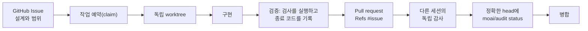

# MoAI ADK

[English](README.md) · **한국어**

MoAI ADK는 Claude Code와 Codex 안에서 하나의 공통 `moai` skill로 같은 작업 흐름(읽기 → 계획 → 실행 → 검증 → 감사 → 동기화)을 돌리고, GitHub Issues를 작업 장부로 쓰는 오픈소스 개발 도구입니다.

> **상태: 출시 전 릴리스 후보(RC)입니다.** 이 가지(`v2026.11.0`)에는 Rust 세대 버전 `2026.11.0-rc.1`(명령 `moai`)이 있습니다. 아직 릴리스 자산은 게시되지 않았습니다. 지금의 안정판은 [`main`](https://github.com/modu-ai/moai-adk/tree/main) 가지의 Go 3.x 세대입니다([릴리스 목록](https://github.com/modu-ai/moai-adk/releases)).

## 누구를 위한 것인가

Claude Code나 Codex로 개발하면서, 모든 변경에 검증 기록과 독립 검토를 남긴 뒤에 병합하고 싶은 개인과 팀을 위한 도구입니다.

## 동작 방식



- **Issue 하나에 세션 하나.** Issue 본문이 설계이고, 보고 댓글이 상태입니다.
- **관측하지 않은 주장은 없다.** 명령을 실제로 실행하고 출력을 읽은 검사만 통과로 셉니다. 실행하지 않은 검사는 통과가 아니라 `not_run`으로 보고합니다.
- **독립 감사.** 작성자가 아닌 세션이 정확한 head 커밋을 검토합니다. 가지 ruleset은 병합 전에 `moai/audit` commit status를 요구합니다.

host가 읽는 작업 흐름 원문은 [skills/moai/](skills/moai/SKILL.md)에 있습니다.

## 상태와 호환

| 항목 | RC1 (`v2026.11.0` 가지) | Go 3.x (`main` 가지) |
| --- | --- | --- |
| 언어 | Rust | Go |
| 명령 | `moai`(별칭 `moai-cli`) | `moai` |
| 버전 | `2026.11.0-rc.1` (prerelease, 미출시) | 최신 릴리스 `v3.1.2` |
| 상태 폴더 | `.moai-cli/`(프로젝트), `~/.moai-cli/`(사용자) | `.moai/`, `~/.moai/` |
| host 진입 | Claude Code `/moai <요청>`, Codex `$moai <요청>` | Claude Code의 `/moai` 명령 |

두 세대는 상태 폴더를 따로 쓰고, 서로를 업데이트하지 않습니다. 두 세대 모두 명령 이름이 `moai`이므로 `moai --version`으로 구별합니다(릴리스 후보는 줄 끝에 `(rust)`가 붙습니다). 릴리스 후보는 같은 출력을 내는 별칭 `moai-cli`도 함께 빌드합니다.

**RC1 목표 범위**는 Apple silicon macOS(`aarch64-apple-darwin`)에서 쓰는 Claude Code와 Codex입니다. 이것은 목표이지 지원 보증이 아닙니다. host가 skill을 읽는 종단 간 시험은 아직 돌리지 않았습니다. Linux, Intel macOS, Windows는 RC1 범위 밖입니다(일부는 CI에서 빌드와 시험만 합니다). 조합별 측정 상태는 [docs/support-matrix.md](docs/support-matrix.md)와 [docs/host-support-matrix.md](docs/host-support-matrix.md)에 있습니다.

## 설치

### 릴리스로 설치 (아직 없음)

RC1 릴리스 자산과 설치 도구는 게시되지 않았습니다. 게시되면 실제 명령을 이 절에 적습니다. 그 전까지 이 절의 명령은 `not_run`입니다. 릴리스 파일은 GitHub artifact attestation으로 검증할 수 있게 할 예정입니다([docs/release-attestation.md](docs/release-attestation.md)).

> 💡 **비용을 줄이려면 — z.ai GLM 추천**: [이 링크](https://z.ai/subscribe?ic=1NDV03BGWU)로 z.ai에 가입하면 일정 토큰을 보너스로 받는다. 이 링크는 moai-adk 오픈소스 개발을 후원하는 경로이기도 하다. 무료 모델(GLM-4.7-Flash, GLM-4.5-Flash)도 있으니 [z.ai 요금제](https://docs.z.ai/guides/overview/pricing)를 참고한다.

### 소스에서 빌드

필요한 것: Git, [rustup](https://rustup.rs/). 툴체인은 [`rust-toolchain.toml`](rust-toolchain.toml)에 고정되어 있습니다(Rust 1.94.1).

```sh
git clone https://github.com/modu-ai/moai-adk.git
cd moai-adk
git checkout v2026.11.0
cargo build --release --locked
./target/release/moai --version
```

마지막 명령은 `moai-cli 2026.11.0-rc.1 (rust)`를 출력합니다. `./target/release/moai-cli --version`도 같은 줄을 출력합니다. 이 명령들은 2026-11-14에 macOS 27.0.1(arm64)에서 빈 Cargo home으로, 가지 커밋 `0e9ad36fc4`에서 실행해 확인했습니다. crate를 받은 뒤 release 빌드는 부하가 큰 기계에서 약 1분 26초 걸렸습니다. 다른 플랫폼에서는 이 절차를 그대로 시험하지 않았습니다.

## 첫 실행

프로젝트 루트에서 연 host 세션에 자연어로 요청하는 것이 기본 진입입니다.

- Claude Code: `/moai 이 프로젝트를 읽고 설정해 줘`
- Codex: `$moai 이 프로젝트를 읽고 설정해 줘`

프로젝트에 `moai` skill을 추가하는 일과 위의 첫 요청은 **아직 종단 간으로 시험하지 않았습니다**(`not_run`, RC1 출시 대기). 사용자 흐름 초안은 [docs/user-entry-draft.md](docs/user-entry-draft.md)에 있습니다.

`moai --help`는 작업 흐름이 부르는 내부 명령을 보여 줍니다. skill이 쓰는 부품이지 매일 직접 쓰는 화면은 아닙니다.

## 사실 정리

- 이름: MoAI ADK (Agentic Development Kit)
- 저장소: https://github.com/modu-ai/moai-adk
- 라이선스: Apache-2.0 ([LICENSE](LICENSE))
- RC1 구현 언어: Rust, 실행 파일 이름 `moai`와 별칭 `moai-cli`
- RC1 버전: `2026.11.0-rc.1` (prerelease, 미출시)
- RC1 목표 host: macOS arm64의 Claude Code와 Codex (host 종단 간 시험 `not_run`)
- 작업 장부: GitHub Issues, 병합 관문: `moai/audit` commit status
- 이전 세대: `main` 가지의 Go `moai` 3.x
- 웹사이트: https://adk.mo.ai.kr (현재 Go 3.x 세대 문서)

## 자주 묻는 질문

**RC1은 Go 3.x와 무엇이 다른가요?**
RC1은 Rust로 새로 만든 세대이고, Claude Code와 Codex가 함께 쓰는 공통 `moai` skill 하나를 둡니다. 상태는 `.moai-cli/`와 `~/.moai-cli/`에 두므로 Go 3.x 설정을 건드리지 않습니다. [docs/rust-product-path.md](docs/rust-product-path.md)를 보세요.

**지금 바로 쓸 수 있나요?**
소스에서 빌드하고 코드와 문서를 읽을 수는 있습니다. 아직 출시 전이고 host 종단 간 시험도 돌리지 않았습니다. 일상 작업에는 지금도 `main`의 Go 3.x가 안정적인 선택입니다.

**Claude Code와 Codex가 둘 다 있어야 하나요?**
아닙니다. 어느 host 하나만으로도 목표 범위에 듭니다. 같은 작업 흐름 원문을 두 host가 함께 쓰고, host별 차이는 [docs/host-support-matrix.md](docs/host-support-matrix.md)에 있습니다.

**내 홈 폴더의 파일을 바꾸나요?**
RC1은 자기 사용자 상태를 `~/.moai-cli/`에 두고 Go 세대의 `~/.moai/`는 바꾸지 않습니다. 관리 파일을 만들거나 적용하는 명령(예: 프로젝트 설정, host 설정, hook, skill 복사)은 plan → apply 짝으로 나뉩니다. plan 단계는 아무것도 쓰지 않고, apply 단계는 plan digest가 없으면 실행을 거부합니다. host의 skill 폴더에 skill을 설치하는 일도 이런 명시적 apply 단계 중 하나입니다.

**어떻게 기여하나요?**
[CONTRIBUTING.md](CONTRIBUTING.md)를 읽어 주세요(영어). 내부의 작업 예약·감사 절차를 따를 필요는 없습니다. 외부 pull request에는 maintainer가 그 절차를 대신 처리합니다.

## 기여, 지원, 보안

- 기여하기: [CONTRIBUTING.md](CONTRIBUTING.md)
- 질문과 도움: [SUPPORT.md](SUPPORT.md)
- 취약점 비공개 신고: [SECURITY.md](SECURITY.md)
- 행동 강령: [CODE_OF_CONDUCT.md](CODE_OF_CONDUCT.md) ([한국어 번역](https://www.contributor-covenant.org/ko/version/3/0/code_of_conduct/))

## 라이선스

Apache License 2.0. [LICENSE](LICENSE)를 보세요.
