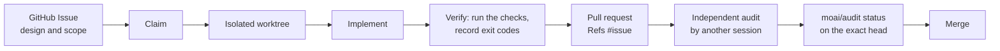

# MoAI ADK

**English** · [한국어](README.ko.md)

MoAI ADK is an open-source development kit that runs one workflow (read → plan → run → verify → audit → sync) inside Claude Code and Codex through a single shared `moai` skill, with GitHub Issues as the work ledger.

> **Status: release candidate, not yet released.** This branch (`v2026.11.0`) holds the Rust generation, `moai-cli 2026.11.0-rc.1`. No release assets are published for it yet. The stable release today is the Go 3.x generation on the [`main`](https://github.com/modu-ai/moai-adk/tree/main) branch ([releases](https://github.com/modu-ai/moai-adk/releases)).

## Who it is for

Developers and teams who build software with Claude Code or Codex and want every change to carry recorded verification and an independent review before it merges.

## How it works



- **One Issue, one session.** Each Issue is the design; its report comment is the state.
- **No unobserved claims.** A check counts as passed only when its command ran and its output was read. Checks that did not run are reported as `not_run`, never as passed.
- **Independent audit.** A session other than the author reviews the exact head commit. The branch ruleset requires the `moai/audit` commit status before a pull request can merge.

The workflow text the hosts load is in [skills/moai/](skills/moai/SKILL.md).

## Status and compatibility

| Item | RC1 (`v2026.11.0` branch) | Go 3.x (`main` branch) |
| --- | --- | --- |
| Language | Rust | Go |
| Command | `moai-cli` | `moai` |
| Version | `2026.11.0-rc.1` (prerelease, unreleased) | latest release `v3.1.2` |
| State folders | `.moai-cli/` (project), `~/.moai-cli/` (user) | `.moai/`, `~/.moai/` |
| Host entry | `/moai <request>` in Claude Code, `$moai <request>` in Codex | `/moai` commands in Claude Code |

The two generations use separate state folders and do not update each other.

**RC1 target scope** is macOS on Apple silicon (`aarch64-apple-darwin`) with Claude Code or Codex. This is a target, not a support guarantee: end-to-end tests of the hosts loading the skill have not run yet. Linux, Intel macOS and Windows are outside RC1 (CI builds and tests some of them). The measured state of every combination is in [docs/support-matrix.md](docs/support-matrix.md) and [docs/host-support-matrix.md](docs/host-support-matrix.md).

## Install

### From a release (not available yet)

Release assets and an installer for RC1 are not published. This section will list the real commands once they exist; until then they are `not_run`. Release files will be verifiable with GitHub artifact attestations ([docs/release-attestation.md](docs/release-attestation.md)).

> 💡 **To cut costs — z.ai GLM recommended**: signing up via [this link](https://z.ai/subscribe?ic=1NDV03BGWU) grants bonus tokens. The link is also a way to sponsor moai-adk open-source development. Free models (GLM-4.7-Flash, GLM-4.5-Flash) exist too — see the [z.ai pricing](https://docs.z.ai/guides/overview/pricing).

### Build from source

Requirements: Git and [rustup](https://rustup.rs/). The toolchain is pinned in [`rust-toolchain.toml`](rust-toolchain.toml) (Rust 1.94.1).

```sh
git clone https://github.com/modu-ai/moai-adk.git
cd moai-adk
git checkout v2026.11.0
cargo build --release --locked
./target/release/moai-cli --version
```

The last command prints `moai-cli 2026.11.0-rc.1`. These commands were run on 2026-11-11 on macOS 27.0.1 (arm64) with an empty Cargo home, at branch commit `1aad1ce01a`; the release build took about 26 seconds after the crate download. Other platforms were not tried with these exact steps.

## First run

The intended entry is natural language in the host session at your project root:

- Claude Code: `/moai read this project and set it up`
- Codex: `$moai read this project and set it up`

Adding the `moai` skill to a project and these first-run requests have **not been tested end to end yet** (`not_run`, pending the RC1 release). The draft user flow is in [docs/user-entry-draft.md](docs/user-entry-draft.md).

`moai-cli --help` lists the internal commands the workflow calls. They are building blocks for the skill, not a daily interface.

## Facts

- Name: MoAI ADK (Agentic Development Kit)
- Repository: https://github.com/modu-ai/moai-adk
- License: Apache-2.0 ([LICENSE](LICENSE))
- RC1 implementation language: Rust; binary name `moai-cli`
- RC1 version: `2026.11.0-rc.1` (prerelease, not yet released)
- RC1 target hosts: Claude Code and Codex on macOS arm64 (host end-to-end tests `not_run`)
- Work ledger: GitHub Issues; merge gate: the `moai/audit` commit status
- Previous generation: Go `moai` 3.x on the `main` branch
- Website: https://adk.mo.ai.kr (currently documents the Go 3.x generation)

## FAQ

**How is RC1 different from Go 3.x?**
RC1 is a rewrite in Rust with one common `moai` skill shared by Claude Code and Codex. It keeps its state in `.moai-cli/` and `~/.moai-cli/`, so it does not touch a Go 3.x setup. See [docs/rust-product-path.md](docs/rust-product-path.md).

**Can I use it today?**
You can build it from source and read the code and documents. It is not released, and the host end-to-end tests have not run. For daily use, the stable choice is still Go 3.x on `main`.

**Do I need both Claude Code and Codex?**
No. Either host is a target on its own. The same workflow text serves both; host differences are listed in [docs/host-support-matrix.md](docs/host-support-matrix.md).

**Does it change files in my home directory?**
RC1 keeps its own user state under `~/.moai-cli/` and does not modify the Go generation's `~/.moai/`. Commands that generate or apply managed files (for example project setup, host settings, hooks and skill copies) come as a plan → apply pair: the plan step writes nothing, and the apply step refuses to run without the plan's digest. Installing the skill into a host's skill folder is one of those explicit apply steps.

**How do I contribute?**
Read [CONTRIBUTING.md](CONTRIBUTING.md). You do not need to follow the internal claim and audit procedure; maintainers handle it for external pull requests.

## Contributing, support and security

- Contribute: [CONTRIBUTING.md](CONTRIBUTING.md)
- Ask a question or get help: [SUPPORT.md](SUPPORT.md)
- Report a vulnerability privately: [SECURITY.md](SECURITY.md)
- Code of conduct: [CODE_OF_CONDUCT.md](CODE_OF_CONDUCT.md)

## License

Apache License 2.0. See [LICENSE](LICENSE).
