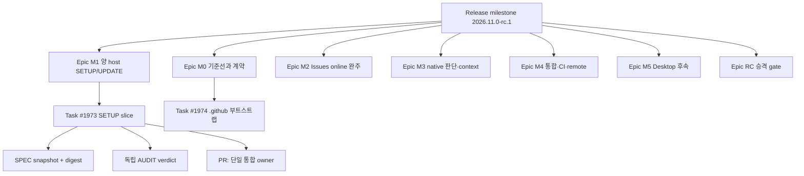

# RC1 GitHub Issues 계획 구조안 (검토용, 2026-11-08)

이 문서는 `2026.11.0-rc.1` 전체 계획을 GitHub Issues로 체계화하는 구조안이다. 설계 스냅샷(2026-11-08 조회, D81까지 반영)과 이전 세대(Go) 자산을 대조한 결과이며, 확정이 아니다. 사용자가 Pages에서 검토한 뒤 후속 지시를 내리기 전까지 Issue 일괄 발행·재분류·라벨 체계 확정은 하지 않는다. 신규 GitHub 발행 권한을 확대하지 않는다.

근거 표기: `00:1290`은 design-snapshot `00-page_43faf…` 1290행이다. 세션 간 분담: 설계 정본 대조(agent-3), 계층·GitHub 기능 조사(agent-4), 소유권·claim 설계 대조(agent-2), 통합과 구현(leader).

## 1. 현재 상태 (이미 수행한 것, 재사용)

| 항목 | 상태 | 근거 |
| --- | --- | --- |
| Issue 원장 | `modu-ai/moai-adk` Issues, milestone `2026.11.0-rc.1`(#1) 생성 | 사용자 결정 2026-11-08 |
| 기존 Issue | #1973 M1 SETUP slice(구현·검증 완료, 독립 감사 4차 대기), #1974 .github 부트스트랩 | 보고 댓글 revision 3 / 1 |
| label | 신설 `host:claude`, `host:codex`, `area:setup`; 재사용 `type:*`, `priority:P0..P3`, `area:*` | 원격 재조회 일치 |
| Issue form | 뼈대 3종 `moai-feature`, `moai-bugfix`, `moai-investigation`(세부 항목은 사용자와 하나씩 결정) | 사용자 결정; `tests/github_assets_test.py` 3건 통과 |
| 미채택 | `label-sync` workflow, agentic-factory 댓글 템플릿 13종, `status:*` label | `.github/moai/README.md` |
| 렌더링 | Issue form은 기본 브랜치에서만 읽힘 → not_run | GitHub 동작 |

## 2. 설계 정본이 정한 것

### 2.1 계층과 정의

- 릴리스 gate: 양 host 발견·명시 호출 → SETUP routing → 초기화·사용자 변경 보존 → 세션 UPDATE 실제 실행, 서버/DB 없는 Issues online 완주, native 판단 fallback (`00:1286`). 필수 실패 gate `00:1302`, "RC 승격" 행 `00:1296`.
- M0~M5는 한 릴리스 안의 **단계**이며 GitHub milestone 개념이 아니다. 제공 결과·완료 조건 표 `00:1290-1295`, 착수 순서 "M0의 source inventory·host spike·updater/tag 경계 검증부터" `00:1324`. Desktop(M5)은 후속이며 완료 조건을 대체하지 못한다.
- F01~F25는 안정적인 제품 요구 ID이며 내부 명령 이름이 아니다 (`02:58`, 표 `00:366-390`). F20·F22~F25 이름은 메인 계획과 체크리스트가 다르다 (`00:390` "보관과 이행" vs `01:131` "공식 host/provider 변화와 호환성 검토"). Issue에는 이름과 출처를 함께 적고 번호를 임의로 맞추지 않는다.
- "epic" 용어는 설계에 없다. 근접 개념은 task 레코드의 `parent_task_id` (`00:587`)와 이전 세대 parent Issue("scope·dependency 추적, work queue 아님", `agentic-factory-01-parent-issue.yml:68`).
- SPEC: GEARS 단일 저작 (`00:520`), Issue에는 초안·논의, 실행 전 승인 SPEC은 snapshot+digest로 고정 (`00:538`, `04:21-27`). 작은 변경은 SPEC+계획+inline AC로 충분 (`00:540`, PLAN-05). `contracts.lock`은 tracked, digest 미정이면 승인 아님 (`00:1003`, `08:74`, `22:62`).
- 승인 레코드: 주체·근거·snapshot digest·허용 행동·유효범위·취소 (`04:27`). 승인 후 Issue 본문 수정은 새 proposal이며 기존 snapshot은 불변 (`04:159`).
- 완료: Done = acceptance + 통합 revision + 최신 검증 + 승인 + sync 연결 (`00:585`). Issue close는 검증이 아니다 (`00:620`, `06:83`).
- 독립 감사: 같은 context 자기 review는 필수 독립 감사를 대체하지 못한다 (`00:593`, `07:108`).

### 2.2 Issues·label 규칙 (이름 체계 아님)

- 설계 스냅샷에는 label 이름 체계가 없다. 정한 것은 규칙만이다: label·assignee·댓글은 lock·claim·상태가 아니다 (`04:17`, `11:72`, `00:591`, `00:607`, D36); 집합 필드를 오래된 전체 값으로 PATCH하지 않고 전용 add/remove로 최소 변경 (`06:71`, `00:622`); 상태는 stable run marker가 있는 소유 댓글 하나 (`06:78`, `00:626`, `22` issue-report `상태: running|blocked|review|done`); Issues가 공식 TODO·진행 원장, Projects는 보기 (`00:601`, D32); 보고는 간결 (D73).
- 이름 체계의 유일한 출처는 이전 세대(Go) 자산이다: `.github/labels.yml`(type/priority/status 3축 + area, `label-sync` 전제), `labels.proposed.yml`(type:epic, area:agentic-factory, agent:managed, risk:*, "status label은 두지 않는다"), Go `git-workflow-doctrine.md §18.6`(type·priority·area 3축 필수, status 보조축). Go 문서가 RC를 구속한다는 문장은 설계에 없다.

### 2.3 소유권·claim (한 세션 = 한 Issue)

- 허용: 같은 Mac 안에서 단일 dispatcher가 로컬 journal과 OS lock으로 배정·attempt epoch·재시도를 직렬화 (`00:589`, `00:591`). 세션의 claim 요청은 dispatcher를 거쳐 판정·기록된다.
- 금지: 여러 host가 assignee·label만 보고 각자 claim (`00:591`); assignee·label·댓글·ETag를 lock으로 사용 (`11:72`, `00:607`, `00:636`); worker가 오래된 값으로 assignees·labels를 직접 PATCH (`00:622`); fencing primitive 없는 무인 takeover (`11:72`, `11:116`).
- 식별자: task_id·attempt·epoch·owner{kind,id}·external_task·base_revision·spec_digest·write_scope·state (`11:15-30`); project·clone·workspace·run ID 구분 (`08:23`); Issue 참조는 (provider, host, project, issue_id) (`00:638`). Issue assignee·실행 owner·provider session·통합 owner는 서로 다른 개념 (`11:11`).
- 상태 전이: attempt `prepared → authorized → submitted → running → result_ready → verifying → accepted/needs_fix → closed`, 분기 `unknown → reconciling`, `cancel_requested → cancelled/unknown` (`11:42-64`); SYNC `ready → reconciling → document_proposed → authorized → publishing → confirmed → closed`, 정지 `needs_amendment/conflict/blocked/publish_unknown` (`06:67`). PR은 closure 보고에 실제 revision·receipt 링크 필수 (`06:79`).
- 복구·handoff: owner crash 시 journal 읽기·외부 task 상태 확인·기존 writer 종료·handoff 검증; partition 시 cross-host claim 금지; 늦게 온 옛 결과는 epoch·base·spec 확인 후 stale 보관 (`11:86-94`). host 전환은 기존 실행 정지·상태 확인·명시 handoff 후 새 attempt.
- 중복 방지: 외부 쓰기 전 operation ID·의도 기록, 후 response ID 기록; idempotency API 없으면 exactly-once를 주장하지 않음 (`11:76`); 한 task의 두 local writer·두 merge owner 거부 (`11:104`).
- 이전 세대: "One Issue is handled by one active agent… The sync phase hands the changes to a pull request" 및 준비 단계 `ACCEPTED → … → READY_ACKED` 전 개발 금지 (`agentic-factory/README.md:37-45`).

## 3. 제안 구조안

| 계층 | GitHub 표현 | 내용 | 완료 조건 |
| --- | --- | --- | --- |
| 릴리스 | milestone `2026.11.0-rc.1` 1개, 통합 브랜치 `v2026.11.0`(2026-11-08 확정; `2026.11.0-rc.1` ref 보존) | 릴리스 gate `00:1286` | gate 전부 + 실패 gate 0건 + RC 승격 행 `00:1296` |
| 단계 epic | 상위 Issue 7개(M0~M5 + RC 승격), owner 없음(work queue 아님) | `00:1290-1296` 제공 결과·완료 조건 인용, 포함 F ID, stable acceptance ID, 하위 task 목록 | 하위 task 전부 `closed_as completed` AND acceptance ID 증거 링크(필요조건; Done 정의 `00:585`가 충분조건) |
| task | sub-issue(native 관계), #1973 형식 = 1 Issue 1 owner | F ID, acceptance ID, SPEC reference(inline AC 또는 snapshot ref+digest), write scope, 검증 명령, Dependencies, evidence | AC별 검증 결과(passed/failed/not_run/blocked/stale) + 독립 AUDIT verdict + PR·통합 revision |
| SPEC | Issue가 아님 | 작은 task는 본문 inline AC; 큰 변경은 승인 snapshot(Git 경로+digest) + `contracts.lock` pin | digest 고정, 승인 레코드 연결 |
| 의존성 | native issue dependencies(blocked_by/blocking) + 본문 Dependencies(사람용 사본) | 단계 간 M0→M1→M2→M3→M4→M5→RC 승격, task 내부 DAG는 PLAN 분해 `04:81` | — |
| F 추적 | task 본문 필드(label 폭증 회피) | F는 M을 가로지름(F01은 M1·RC 승격 양쪽) | — |
| 상태 | 소유 보고 댓글 1개(stable run marker), label 아님 | `상태: running|blocked|review|done` + 증거 | — |
| 쓰기 주체 | 계층·관계·label 변경은 leader 1명(single projection writer, `00:622`) | 세션은 변경 의도만 보고 | — |

### 3.1 한 세션 = 한 Issue 운용안 (설계 허용 범위)

1. **claim**: 세션이 claim을 요청하면 leader(dispatcher)가 로컬 journal(`<state_root>`, O_EXCL/flock)에 `task_id·attempt·epoch·owner`를 기록해 직렬화한다. GitHub assignee는 **표시**로만, leader만 add API로 추가한다(기존 assignee 보존, lock 아님).
2. **준비**: 이전 세대의 `READY_ACKED` 전 개발 금지를 attempt `prepared → authorized`에 대응(결정 D5). branch·worktree는 세션별 격리(한 task에 writer 하나).
3. **실행·검증**: 세션이 구현 → 실제 검증 → 증거를 Issue 소유 댓글에 보고(의미 있는 전환만). heartbeat는 journal.
4. **감사**: 별도 context의 독립 AUDIT verdict 없이는 완료 아님.
5. **PR·통합**: 세션이 PR을 열되 merge는 단일 통합 owner(결정 D6). epoch 검사는 publish 경로(댓글·PR·push)에서 강제(결정 D4).
6. **중단·재개·인계**: lease 만료 시 자동 takeover 없음; leader가 journal·외부 상태 확인 후 명시 handoff로 새 attempt(결정 D2). 늦게 온 옛 결과는 stale 보관.
7. **리더 관리**: 진행·차단·완료를 journal과 소유 댓글로 추적; 서로 다른 Issue는 병렬.

## 4. GitHub native 기능 확인 (2026-11-08, gh 2.92.0, 읽기 호출만)

| 기능 | 결과 |
| --- | --- |
| Milestone | 사용 중(#1, open_issues 2) |
| Sub-issues | 저장소 API 응답에 `sub_issues_summary` 존재, `GET issues/1973/sub_issues` → `[]`. 공식 문서: 부모당 100개, 8단계 중첩, 같은 owner 제약, `sub_issue_id`는 Issue 숫자 id(#1973 → id 6267911221). `gh issue create/edit`에 parent 플래그 없음 → `gh api` 필요. 쓰기 미시험 |
| Issue dependencies | `GET issues/1973/dependencies/blocked_by` → `[]`, 사용 가능해 보임, 쓰기 미시험 |
| Issue types | org에 Task/Bug/Feature 정의, #1973/#1974 type=null, Epic 타입 없음(org admin 작업) |
| Projects v2 | 토큰 scope 부족(`read:project` 없음), repo `has_projects=false`; 설계상 보기일 뿐 |
| 권한 | repo admin/maintain/push=true |

## 5. 사용자 결정이 필요한 항목

1. milestone 단위: 릴리스 1개(현재) vs M0~M5별.
2. epic 계층(상위 Issue 7개) 도입 여부; F ID는 본문 필드/label/F epic 중 무엇으로.
3. SPEC·`contracts.lock` 위치: 설계는 `.moai/contracts.lock` tracked인데 이 저장소는 `.moai/` 미추적·unborn HEAD(P09 미결).
4. 의존성: native dependencies 사용 여부; projection writer를 leader 단독으로.
5. P04: M3 일부·M4·M5를 이 milestone에 둘지 후속으로.
6. label: `status:*` 사용 여부(Go labels.yml·원격 존재 / 설계·proposed 미사용), 신설 `host:*`·`area:setup` 추인, `type:epic` 채택, type/priority/area 필수 여부, 원격 레거시 동의어(bug/enhancement/critical…) 처리, `area:router/update/forge` 생성 여부, Issue type(Task/Feature) vs `type:*` label.
7. F 번호 불일치(00 vs 01)에서 Issue에 쓸 체계.
8. 순서 이탈: M0 미완료 상태에서 M1 slice(#1973) 진행 중 → M0 blocks M1로 걸지, 수용된 이탈로 기록할지.
9. V01~V19 구현 검증 체크리스트를 별도 task로 둘지, 각 task AC로 흡수할지.
10. 소유권 설계 P08: claim primitive(①로컬 journal+OS lock ②원격 Git ref create-if-absent ③CI concurrency ④Go factory lease 의미 재사용), lease 만료 처리(명시 handoff 기본), heartbeat 주기·만료 수치(P11), epoch 강제 지점, 준비 단계 계승, 통합(merge) owner, Issue 표시 필드.
11. 템플릿: 현재 3종(feature/bugfix/investigation) vs 이전 세대 parent/child/spec-change; 철회한 amendment form의 재도입 여부(`06:42` amendment 흐름).
12. 보존: Go MoAI가 읽는 루트 `AGENTS.md`(관리 구간 추가됨)·`AGENTS.local.md`(신규)의 처리 — 유지 / 구간 제거. 경로는 확정됨: Rust 프로젝트 데이터 `.moai-cli/`, Rust 홈 설치 `~/.moai-cli/`; Go `.moai/`·`~/.moai/` 보존. 기존 `.moai/project.yaml`·`.moai/manifests/generation.json`(생성 시점 해시와 동일, 사용자 변경 없음, Go 참조 없음)은 보존 상태로 두고 `.moai-cli/`에 재생성.
13. RC 브랜치 첫 commit·push(remote 추가 포함) 여부.

## 6. 기존 Issue 배치안

- #1973(M1 SETUP slice) → M1 epic의 sub-issue. F02·F03 일부, acceptance GENERATION-IDEMPOTENT·GENERATION-USER-EDIT. M0와의 관계는 결정 8.
- #1974(.github 부트스트랩) → 기본 제안 M0 epic 하위(기준선과 계약), 대안 "RC 운영" parent. 다른 task의 선행이므로 blocking 후보.

## 7. 보존 주의와 Gaps

- 이 폴더(`~/moai/moai-adk`)의 `.moai/`·`.claude/`는 Go MoAI가 사용하는 이전 세대 상태다. 첫 dogfooding이 새 파일 3개(`.moai/project.yaml`, `.moai/manifests/generation.json`, `AGENTS.local.md`)를 만들고 `AGENTS.md`에 관리 구간을 추가했다. 기존 파일 덮어쓰기는 없고, Go 소스의 `project.yaml` 참조는 모두 `.moai/config/sections/project.yaml`(다른 경로)이며 두 신규 경로를 가리키는 참조는 없다. 다만 Go 소스는 루트 `AGENTS.md`·`AGENTS.local.md`를 frozen instruction file로 읽는다(`internal/contract/frozen.go`, `token_budget_guard.go`). 삭제·되돌리기는 하지 않았다. 사용자 확정(2026-11-08)에 따라 Rust RC는 `<project>/.moai-cli/`와 `~/.moai-cli/`를 쓰고 Go 폴더는 보존한다.
- 설계 스냅샷은 2026-11-08 조회본이며 원본 Page 최신본과 대조하지 않았다. `00` 전문은 grep 범위만 읽었다.
- GitHub 쓰기(sub-issue·dependency·type)는 모두 미시험이다.
