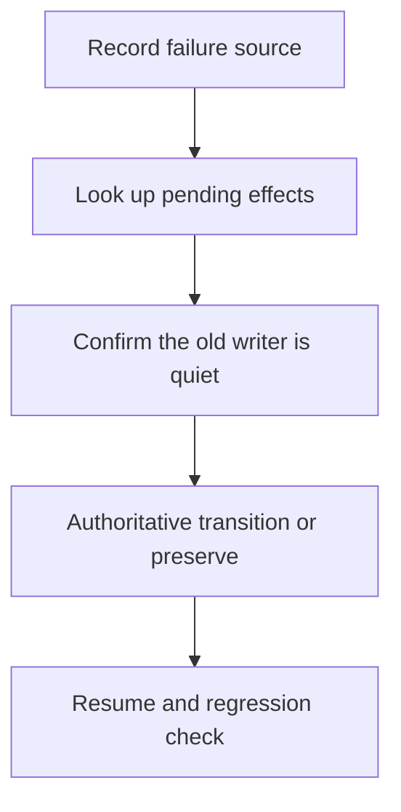

<!-- moai-template:14-recovery@1.0.0; machine metadata is correlation only, never authorization -->
# Resume and Regression — {{ Issue title }}

Reusable comment source. No repository file is read for comment templates on this provider: copy the body below into a note.

| Common field | Value |
|---|---|
| actor / role / session_id | {{ authenticated actor, role and session }} |
| Issue / repo immutable ID | {{ canonical URL and immutable ID }} |
| template_version / policy_revision | 1.0.0 / {{ policy hash }} |
| source_event_id / source_revision | {{ source event and revision }} |
| effect_id / request_id / dedup_key | {{ publish intent ID and canonical payload hash }} |
| collector_cursor / adopted_revision / consumer_ack | {{ record collection, adoption and ACK separately; give the reason when not applicable }} |
| head_sha / base_sha / spec_hash | {{ value, or not applicable with the reason }} |
| observed_at / original_evidence | {{ RFC 3339 time with offset; original URL, log or receipt }} |
| current state / next action / owner | {{ observed state and the next trigger }} |

## Original Issue, failure family and cycle

{{ Write from evidence. State anything unverified or not run explicitly. }}

## State before the failure and pending effects

{{ Write from evidence. State anything unverified or not run explicitly. }}

## Evidence that the previous writer and its descendants can no longer write

{{ Write from evidence. State anything unverified or not run explicitly. }}

## New epoch or reconnect of the existing owner

{{ Write from evidence. State anything unverified or not run explicitly. }}

## Original evidence and payload consistency

{{ Write from evidence. State anything unverified or not run explicitly. }}

## Regression matrix and preserved budgets

{{ Write from evidence. State anything unverified or not run explicitly. }}

## Resumable, or RECOVERY_REQUIRED

{{ Write from evidence. State anything unverified or not run explicitly. }}

## Execution logic diagram

The Mermaid source below is a structure template. Complete it with the real branches, failures and resume conditions of this work before it is rendered. A platform-rendered Mermaid fence is not the pinned renderer's output.

- source SHA-256: {{ hash of the final Mermaid source }}
- Render status: {{ PASS, or RENDER_BLOCKED; never record NOT_RUN as PASS }}
- Pele version / bundle hash: {{ pinned version and bundle hash }}
- light / dark SVG SHA-256 and URI: {{ actual render results }}
- Pele SVG: not generated (renderer unavailable) — see GAP-PELE-SVG
- Render, sanitize, contrast and layout QA: {{ each result; NOT_RUN is never PASS }}
- Text description: {{ flow, failures, approvals, recovery and completion conditions }}

## Publishing rules

- Redaction rule: never write tokens, API keys, credentials or cookies; personal data (email addresses, personal names, user-identifying local paths); absolute home-directory paths (use repository-relative paths); raw logs, environment dumps or stack traces (write a short summary and link an accessible artifact); or content copied from private remotes or private repositories. If sensitive content was already posted, stop and report it to the operator instead of silently editing history.
- Comment style: summary and delta only. Say what changed since the previous revision, link the evidence, and name the next action. Do not repeat the full Issue body, earlier comments or logs, and post nothing when nothing substantive changed.
- Rate-limit stance: when a provider budget is exhausted or a request is refused with 401, 403 or 429, wait for the provider-stated reset or retry-after time and record the blocker. Never work around it with a new key, token or account, and never post extra comments to compensate.
