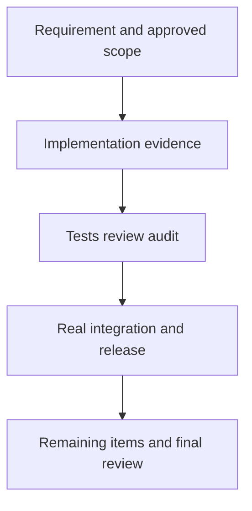

<!-- moai-template:15-final-report@1.0.0; machine metadata is correlation only, never authorization -->
# Final Report — {{ Issue title }}

Reusable comment source. No repository file is read for comment templates on this provider: copy the body below into a note.

| Common field | Value |
|---|---|
| actor / role / session_id | {{ authenticated actor, role and session }} |
| Issue / repo immutable ID | {{ canonical URL and immutable ID }} |
| template_version / policy_revision | 1.0.0 / {{ policy hash }} |
| source_event_id / source_revision | {{ source event and revision }} |
| effect_id / request_id / dedup_key | {{ publish intent ID and canonical payload hash }} |
| collector_cursor / adopted_revision / consumer_ack | {{ record collection, adoption and ACK separately; give the reason when not applicable }} |
| head_sha / base_sha / spec_hash | {{ value, or not applicable with the reason }} |
| observed_at / original_evidence | {{ RFC 3339 time with offset; original URL, log or receipt }} |
| current state / next action / owner | {{ observed state and the next trigger }} |

## Confirmation time and baseline revision

{{ Write from evidence. State anything unverified or not run explicitly. }}

## What is actually complete and what is not

{{ Write from evidence. State anything unverified or not run explicitly. }}

## Design, implementation, tests and release are reported separately

{{ Write from evidence. State anything unverified or not run explicitly. }}

## Issue, pull or merge request and merge SHA

{{ Write from evidence. State anything unverified or not run explicitly. }}

## Original evidence and verification limits

{{ Write from evidence. State anything unverified or not run explicitly. }}

## Remaining blockers and next action

{{ Write from evidence. State anything unverified or not run explicitly. }}

## Items for the user's final review

The leader owns closing the Issue and the final report. Rendering a report is not a statement that the work was verified; verification is whatever the evidence above shows.

## Context ledger

The latest index lives in the Issue's canonical context block. A comment carries only the entries that changed: the item, the reason, the new revision, a short result and the link.

| entry_id | revision | kind | repo-relative path | commit-pinned link | artifact commit | artifact sha256 | target head | owner (role, session_id) | verification state | verified_at | accessibility |
|---|---|---|---|---|---|---|---|---|---|---|---|
| {{ stable id }} | {{ number }} | {{ spec / plan / decision / failure / regression / audit / pr_handoff / completion / other }} | {{ path }} | {{ link pinned to the full artifact commit }} | {{ full commit }} | {{ digest of the file bytes }} | {{ full head, or N/A with the reason }} | {{ role, immutable session_id }} | {{ PENDING / NOT_RUN / PASS / FAIL / BLOCKED / UNKNOWN / STALE / LINK_BLOCKED }} | {{ RFC 3339 time }} | {{ accessible / inaccessible-local / inaccessible-unpushed / unknown }} |

Ledger rules:

- A link is evidence only when it is a commit-pinned link: host, owner, repository, blob, the full artifact commit, then the repository-relative path. Branch-based links, short hashes and local file links are not evidence.
- Material that exists only on a local machine, or only in a commit that has not been pushed, is recorded with accessibility inaccessible-local or inaccessible-unpushed and verification state LINK_BLOCKED. It is never presented as team-accessible.
- An entry becomes STALE when the target head changes, the artifact sha256 no longer matches the file bytes, or the adopted contract revision changes. A STALE entry is kept with its original verdict preserved; it is never deleted.
- PENDING and NOT_RUN are not results, and an empty link is not completion evidence. A digest does not prove that the content is correct.
- The artifact commit (where the file lives) and the target head (the code the file describes or verifies) are separate fields.

## Execution logic diagram

The Mermaid source below is a structure template. Complete it with the real branches, failures and resume conditions of this work before it is rendered. A platform-rendered Mermaid fence is not the pinned renderer's output.

- source SHA-256: {{ hash of the final Mermaid source }}
- Render status: {{ PASS, or RENDER_BLOCKED; never record NOT_RUN as PASS }}
- Pele version / bundle hash: {{ pinned version and bundle hash }}
- light / dark SVG SHA-256 and URI: {{ actual render results }}
- Pele SVG: not generated (renderer unavailable) — see GAP-PELE-SVG
- Render, sanitize, contrast and layout QA: {{ each result; NOT_RUN is never PASS }}
- Text description: {{ flow, failures, approvals, recovery and completion conditions }}

## Publishing rules

- Redaction rule: never write tokens, API keys, credentials or cookies; personal data (email addresses, personal names, user-identifying local paths); absolute home-directory paths (use repository-relative paths); raw logs, environment dumps or stack traces (write a short summary and link an accessible artifact); or content copied from private remotes or private repositories. If sensitive content was already posted, stop and report it to the operator instead of silently editing history.
- Comment style: summary and delta only. Say what changed since the previous revision, link the evidence, and name the next action. Do not repeat the full Issue body, earlier comments or logs, and post nothing when nothing substantive changed.
